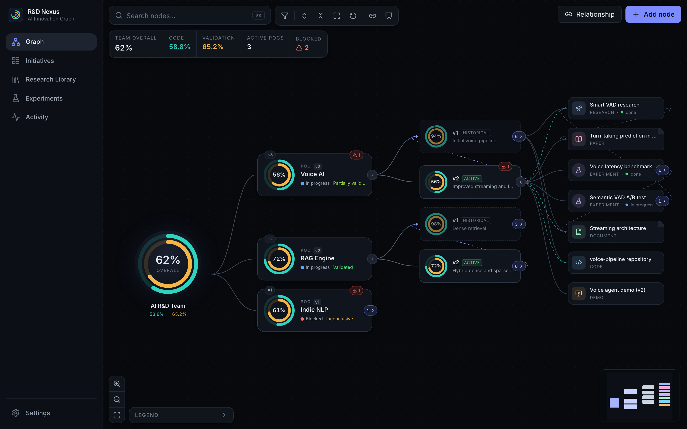
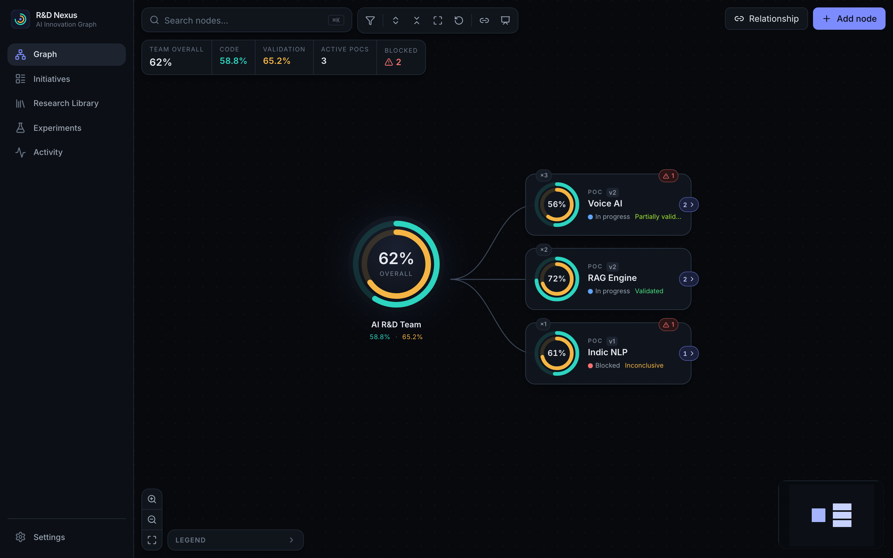
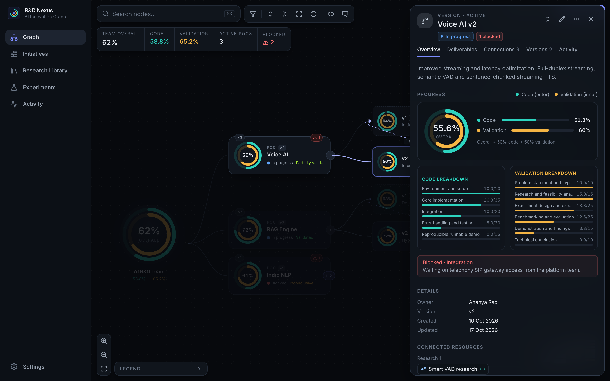
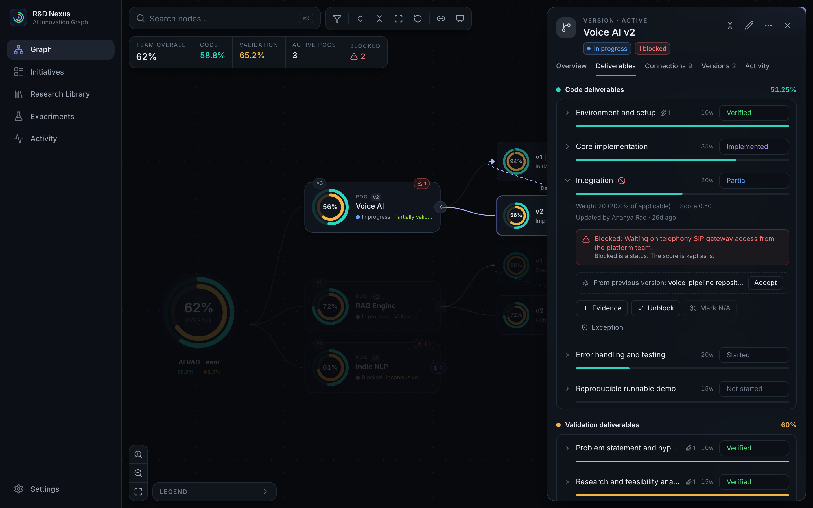
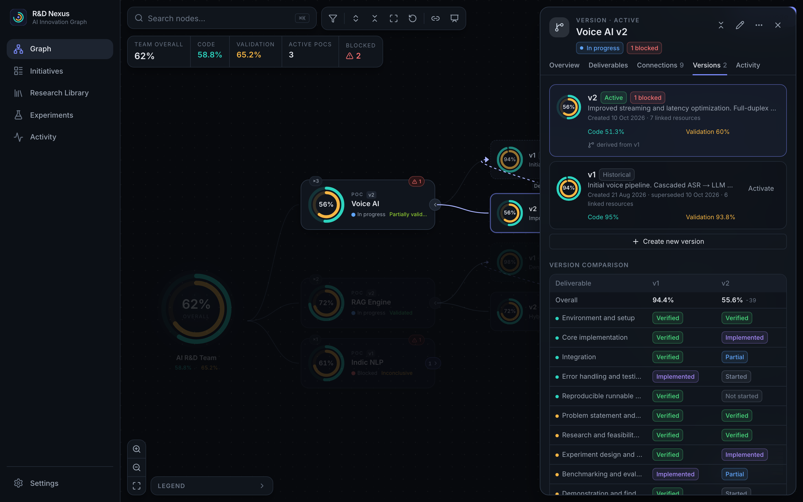
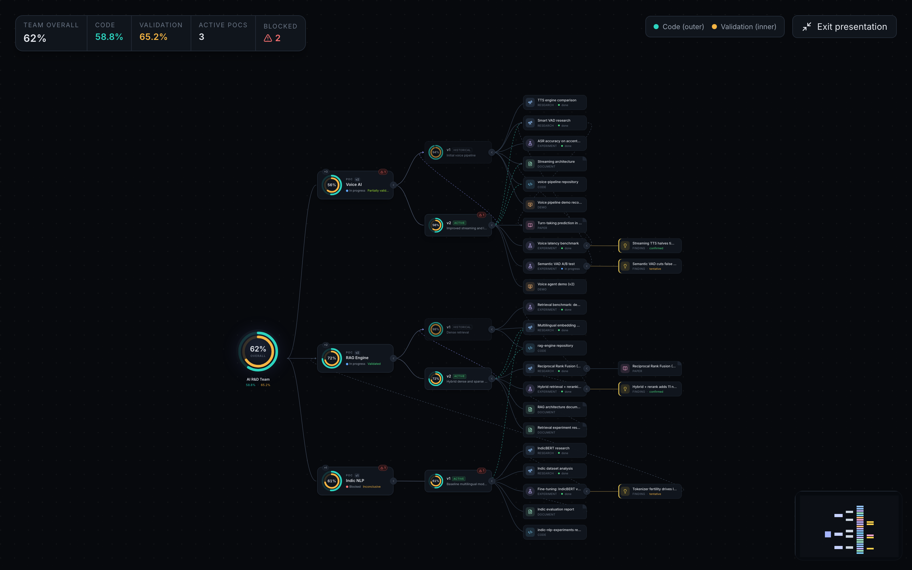
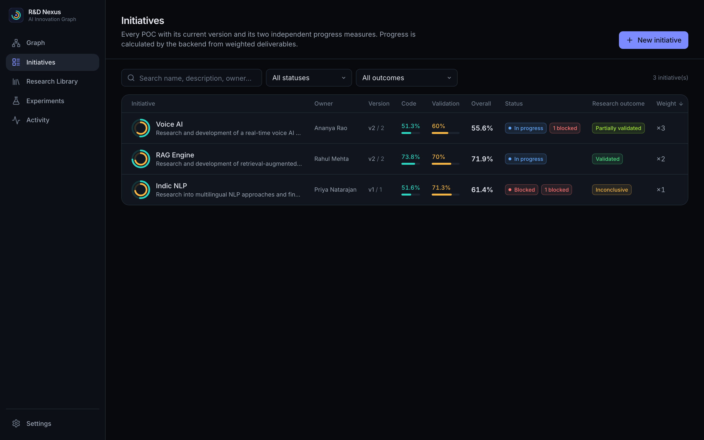
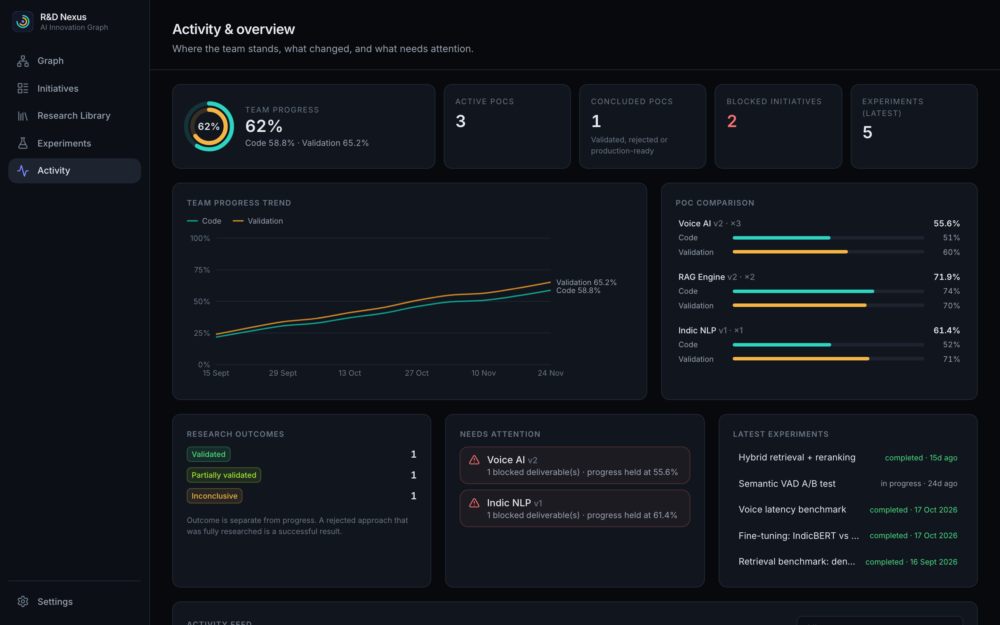
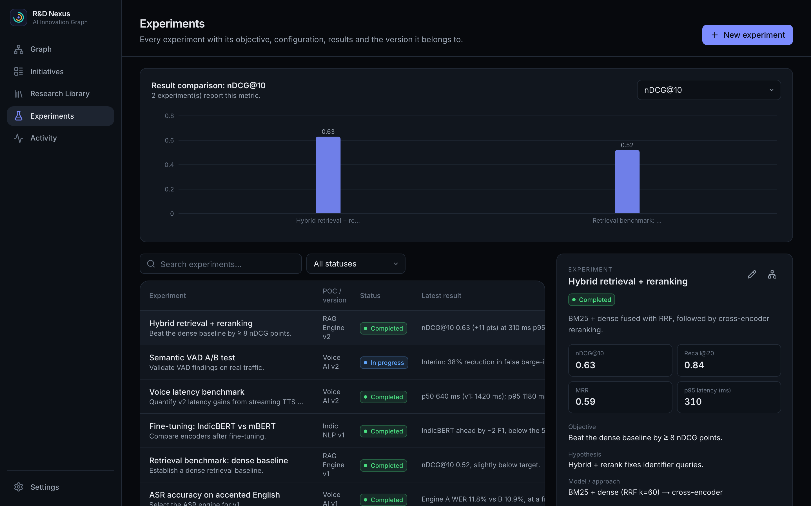
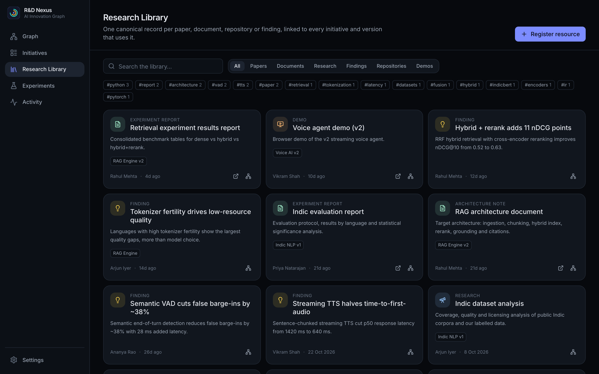

# R&D Nexus: AI R&D Innovation Graph

An interactive knowledge graph of the AI R&D team's initiatives, POC versions, research, experiments,
findings and resources. It tracks **code** and **validation** progress independently, and the backend
calculates both.



## Screenshots

### Graph: the landing view
The team root shows importance-weighted progress across active POCs. Each POC and version node has two
independent rings: **code** (teal, outer) and **validation** (amber, inner). The badges show importance
weight (×3) and blocked deliverables (⚠).



### Inspecting a version
The first click on a node expands it, and the next click opens its details. The panel shows
backend-calculated progress, a per-deliverable breakdown and any blockers, while the graph stays visible
and the selected node's neighbourhood is highlighted.



### Deliverables editor
Each deliverable has a weight, a completion state, evidence, a blocked flag, an N/A flag and a
verification exception. **Verified** stays disabled until evidence is attached. Evidence from the
previous version can be explicitly accepted into the new one.



### Versions and comparison
Every version is scored independently. Historical versions stay accessible and read-only, and the
comparison table shows how each deliverable evolved.



### Presentation mode
The whole research ecosystem fully expanded, with toolbars and navigation hidden, for leadership reviews.



### Initiatives table
A sortable, filterable table for readers who prefer rows to a graph. Research outcome is shown
separately from progress.



### Activity and management overview
Team progress trend, POC comparison, research outcomes, blocked initiatives and a filterable activity
feed.



### Experiments
Objective, configuration, metrics and conclusions for each experiment, with a cross-experiment metric
comparison.



### Research Library
One canonical record per paper, document, repository or finding, linked to every initiative and version
that uses it.



## Run it

```bash
# API (FastAPI + SQLAlchemy + Alembic; SQLite by default)
cd backend
uv sync
uv run alembic upgrade head
uv run python -m app.seed            # --reset to wipe and re-seed
uv run uvicorn app.main:app --port 8000 --reload

# Web (Next.js + React Flow); proxies /api/* to :8000
cd frontend
npm install
npm run dev                          # http://localhost:3000
```

Tests and checks:

```bash
cd backend && uv run pytest          # progress engine + end-to-end API workflow
cd frontend && npx tsc --noEmit && npm run lint && npm run build
```

Postgres: see `docker-compose.yml`. The schema and migrations are portable, so you only need to set
`RDN_DATABASE_URL`.

## Architecture

| Layer | Location | Notes |
|---|---|---|
| Progress engine | `backend/app/services/progress.py` | Pure functions with no DB access. The single source of truth for all scoring. |
| Business rules | `backend/app/services/{deliverables,versions,graph}.py` | N/A, verified-needs-evidence, blocked, version lifecycle, edge validation, activity log |
| Data model | `backend/app/models.py` + `alembic/` | Relational: nodes and edges are separate tables. Typed extensions: `poc_initiatives`, `poc_versions`, `resources` |
| API | `backend/app/api/*` | REST. `GET /api/graph` returns nodes and edges with calculated progress |
| Graph UI | `frontend/src/features/graph` | React Flow custom nodes, ELK layered layout, expand/collapse state in zustand |
| Details panel | `frontend/src/features/panel` | Overview, deliverables editor, connections, versions and comparison, activity |
| Pages | `frontend/src/app/*` | Graph (default), Initiatives, Research Library, Experiments, Activity & overview, Settings |

### Progress model
- Completion scale: Not started 0 · Started 0.25 · Partial 0.5 · Implemented 0.75 · Verified 1.0.
- Category progress = Σ(weight × score) / Σ(applicable weights). N/A items are excluded and the
  remaining weights are re-normalized.
- Overall = 0.5 × code + 0.5 × validation (`RDN_CODE_WEIGHT` / `RDN_VALIDATION_WEIGHT`).
- Team = importance-weighted mean of each active initiative's **active version**, computed separately
  for code and validation. Historical versions never count.
- BLOCKED is a flag and never changes a score. VERIFIED requires evidence or a logged exception.
- N/A is only allowed before work starts (`ever_started` prevents trimming scope after the fact), and
  it requires a reason that is logged.

## Decisions and deviations

- **SQLite by default, Postgres-ready.** No Postgres was available locally. Types are portable, and the
  circular FK between initiative and active version is added after both tables exist on Postgres.
- **Initiative and version tables use the node id as their primary key.** This avoids a second id per entity.
  `/api/pocs/{id}` and `/api/versions/{id}` both take the graph node id.
- **Hierarchy vs cross-links.** `OWNS`, `HAS_VERSION`, `CONTAINS`, `PRODUCED` and `SHARES_RESOURCE`
  drive expand/collapse. `REFERENCES` and `DERIVED_FROM` are drawn as dashed cross-links when both ends
  are visible. The backend rejects hierarchy cycles.
- **Layout.** ELK lays out only the *visible* subgraph, left to right, ordered by the hierarchy. When a
  branch opens, existing nodes keep their column and order and glide to make room. Dragged nodes are
  pinned and persisted, and "Reset layout" in the filters panel clears the pins.
- **Click semantics.** Clicking a collapsed node expands it. Clicking an expanded node or a leaf opens
  its details. A chevron on each node and a button in the panel both toggle the branch.
- **Historical versions are read-only.** Evidence from an older version is offered on the matching
  deliverable of its successor and is copied only when someone explicitly accepts it. The acceptance
  is logged.
- **No auth yet.** The acting user is the name set in Settings and is sent as `X-Actor`. Every mutation
  records it in the activity log.
- **UI kit.** Small hand-written primitives in `components/ui` (Tailwind) instead of generated shadcn
  components. The API is shadcn-like, so swapping later is mechanical.
- **Chart colors.** Rings use the brand teal and amber. Chart marks use darker steps of the same hues,
  validated for contrast and colorblind separation on the dark surface (`--chart-*` tokens).
- **Seed URLs** use `example.*` domains: they are placeholders, not real integrations.
